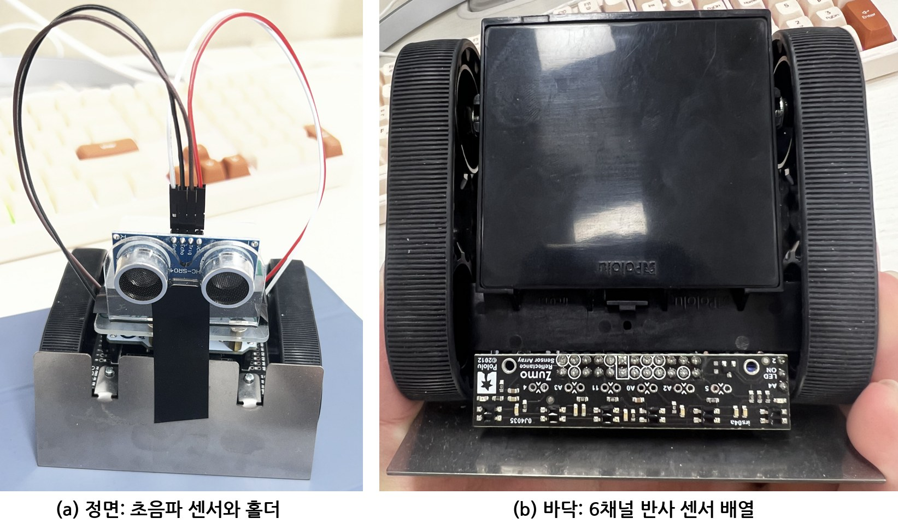
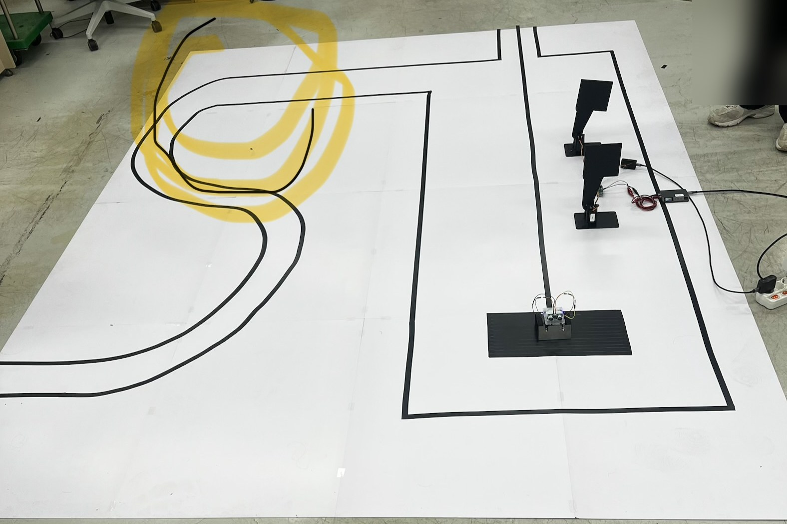
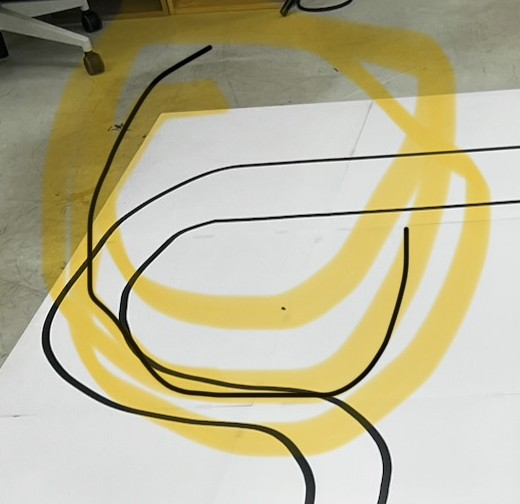
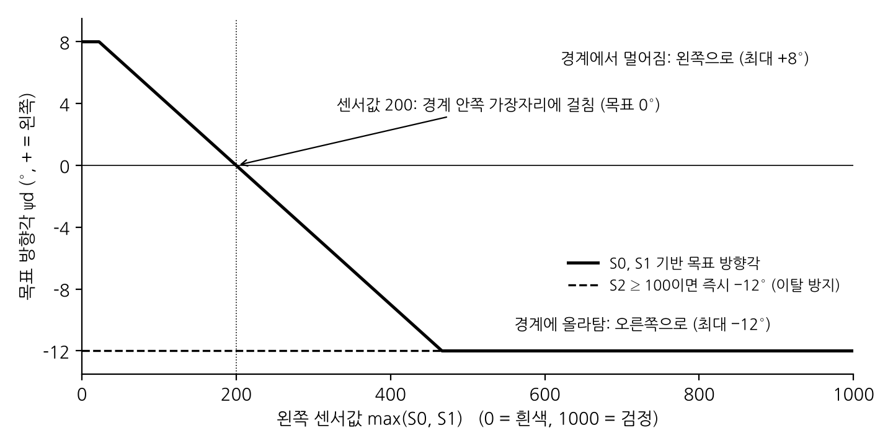
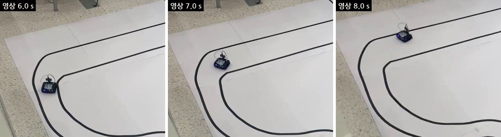
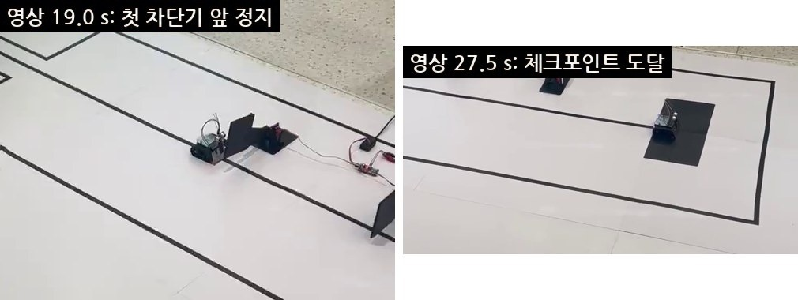

# Aerospace Sensor System 2026 - Term Project 1 Report

**Autonomous Zumo Robot for Curved-Lane Following and Obstacle-Course Navigation**

| 항목 | 내용 |
| --- | --- |
| 학번 | 2022-10949 |
| 이름 | 최장혁 |
| 제출일 | 2026년 11월 19일 |
| 개발 환경 | Arduino Uno, Zumo Shield, PlatformIO |

## 1. 프로젝트 개요

본 프로젝트의 목표는 Zumo 로봇이 사용자의 버튼 입력으로 출발하여 약 16 cm 폭의 곡선 차로를 주행하고, 중앙선을 따라 고정 장애물과 승강식 차단기를 통과한 뒤 회색 체크포인트에서 방향을 전환하여 종료선까지 복귀하도록 만드는 것이다. 로봇을 주행 중에 사람이 만지지 않고 90초 이내에 전 과정을 수행해야 하므로, 빠른 주행뿐 아니라 센서 오측정과 코스 이탈에 대응하는 안정적인 제어가 필요하다.

구현은 제공된 스켈레톤의 일곱 상태 `WAIT`, `LANE`, `OBSTACLES`, `AVOID`, `CHECKPOINT`, `RETURN`, `FINISH`를 유지하면서 각 상태의 실제 동작과 전환 조건을 완성하는 방식으로 진행했다. 곡선 구간에서는 6채널 IR 센서와 자이로를 함께 사용하고, 장애물 구간에서는 IR 중앙선 추종과 초음파 거리 측정을 결합했다.

## 2. 하드웨어 구성

로봇은 Arduino Uno와 Zumo Shield를 기본 플랫폼으로 사용했다. 바닥 상태는 전방의 6채널 반사형 IR 센서 배열로 읽고, 차단기까지의 거리는 전방 초음파 센서로 측정했다. Zumo에 장착된 LSM6DS33의 자이로 축을 이용해 곡선 주행과 90도 및 180도 회전 각도를 추정했다.

| 구성 요소 | 역할 | 연결 또는 설정 |
| --- | --- | --- |
| Arduino Uno | 전체 제어 프로그램 실행 | ATmega328P, 16 MHz |
| Zumo Shield 및 좌우 모터 | 차동 구동 | 방향 D7/D8, PWM D9/D10 |
| 6채널 IR 센서 | 차로 경계, 중앙선, 체크포인트 검출 | D4, A3, D11, A0, A2, D5 |
| IR 발광부 | 바닥 반사광 측정 | D2 |
| LSM6DS33 | 각속도와 누적 회전각 측정 | I2C 주소 `0x6B` |
| 초음파 센서 | 승강식 차단기 거리 측정 | TRIG D6, ECHO D3(INT1) |
| 사용자 버튼 | 출발 및 비상 정지 | D12, 내부 풀업 |
| 노란 LED | 자이로 보정 완료 및 기록 저장 표시 | D13 |



반사 센서 배열은 로봇 전방 하단에 바닥과 가깝게 장착되어 있으며, 기판에 표시된 대로 왼쪽부터 D4, A3, D11, A0, A2, D5 핀에 연결된다(그림 1(b)). 초음파 센서는 아크릴 홀더에 끼워 Uno 위에 고정했고, 핀이 위쪽을 향하도록 뒤집어 장착하여 점퍼선이 센서 앞을 가리지 않게 했다(그림 1(a)).

초음파 센서는 두 원통이 진행 방향을 향하도록 장착했다. ECHO 신호는 외부 인터럽트를 사용할 수 있는 D3에 연결하고, TRIG 신호는 D6에서 약 10 us 펄스로 발생시켰다.

반사 센서 배열이 앞쪽 확장 헤더의 D2, D4, D5, D11, A0, A2, A3를 사용하므로, 초음파 센서는 Zumo Shield 가장자리의 D3, D6, 5V, GND 확장 구멍에 핀 헤더를 납땜하고 암-암 점퍼선으로 연결했다. Zumo Shield의 부저 점퍼는 연결 위치에 따라 부저를 D3 또는 D6에 연결하므로, ECHO와 TRIG 신호에 부저가 함께 물리지 않도록 점퍼 블록을 제거했다. 실제 로봇에서 좌우 모터의 속도 차이가 확인되어 오른쪽 모터 명령에 `0.990`의 보정 계수를 적용했다. 시뮬레이터에서는 제공된 구동 모델에 맞춰 별도의 계수 `1.031`을 사용한다.

## 3. 센서 처리와 보정

### 3.1. IR 센서

각 IR 채널은 흰 바닥과 검은 테이프에서 측정한 방전 시간을 이용하여 0부터 1000까지 정규화했다. 실제 로봇에서 사용한 기준값은 다음과 같다.

| 센서 | S0 | S1 | S2 | S3 | S4 | S5 |
| --- | ---: | ---: | ---: | ---: | ---: | ---: |
| 흰 바닥 원시값 | 188 | 156 | 116 | 156 | 156 | 156 |
| 검은 테이프 원시값 | 2000 | 2000 | 2000 | 2000 | 2000 | 2000 |

검정 기준값은 방전 시간 측정의 제한 시간인 2000 us로 두었다. 11월 10일 측정에서 검은 테이프 위의 원시값은 약 1690 us였고(S3 1688 us), 이 경우 정규화 값은 약 830으로 검정 판정 임계값 600보다 충분히 크다.

정규화 식은 다음과 같다.

```text
irValue = 1000 * (raw - white) / (black - white)
```

계산 결과는 0에서 1000 사이로 제한했다. 중앙선 위치는 여섯 센서에 `{-5, -3, -1, 1, 3, 5}`의 가중치를 적용한 가중평균으로 구했다. 작은 반사 신호는 제거하고 강한 신호는 제한하여 특정 채널의 감도 차이가 조향을 지배하지 않도록 했다.

### 3.2. 자이로

전원이 켜진 뒤 로봇을 정지시킨 상태에서 200개의 자이로 샘플을 평균하여 영점 편향을 구했다. 보정이 완료되면 노란 LED가 켜진다. 주행 중에는 보정된 각속도를 시간에 대해 적분하여 `heading`을 계산한다. 버튼 입력 후에도 1초를 기다렸다가 출발하도록 하여 사용자가 손을 떼는 동안 발생하는 자세 변화를 줄였다.

### 3.3. 초음파 센서

ECHO 펄스 폭을 다음 식으로 거리로 변환했다.

```text
distance_cm = echo_width_us / 58
```

측정은 60 ms마다 수행하며 최근 5개 측정값의 중앙값을 사용한다. 30 ms 안에 ECHO가 끝나지 않으면 유효한 물체가 없다고 판단하여 `999`를 저장한다. 단일 측정의 잡음 때문에 로봇이 정지하는 문제를 줄이기 위한 처리다.

1차 시도의 차단기 정지 기준은 15 cm이다. 로봇이 차단기를 감지해 정지한 뒤 거리가 19 cm보다 큰 상태가 120 ms 유지되면 차단기가 올라간 것으로 판단하고 다시 출발한다. 통과 후 약 30 cm를 이동하면 다음 차단기 검출을 다시 활성화한다.

## 4. 제어 소프트웨어

### 4.1. 상태 기계

전체 동작은 다음 순서로 진행된다.

```text
WAIT -> LANE -> OBSTACLES -> CHECKPOINT -> RETURN -> FINISH
                    |                        |
                    +------> AVOID <---------+
                              |
                              +---- 이전 상태로 복귀
```

| 상태 | 주요 동작 | 전환 조건 |
| --- | --- | --- |
| `WAIT` | 자이로 영점 보정, 모터 정지 | 보정 완료 후 버튼 입력과 1초 대기 |
| `LANE` | 곡선 차로 내부 주행, 왼쪽 경계 추종, 합류선 정렬 | 우회전 후 중앙선 획득 |
| `OBSTACLES` | 중앙선 추종, 차단기 및 체크포인트 탐색 | 차단기 검출 또는 회색 패드 도달 |
| `AVOID` | 차단기가 올라갈 때까지 정지 | 초음파 거리 19 cm 초과가 120 ms 유지 |
| `CHECKPOINT` | 패드 내부 정지, 180도 회전, 패드 이탈 | 회색 패드를 완전히 벗어남 |
| `RETURN` | 중앙선을 반대 방향으로 추종 | 종료선 통과 조건 만족 |
| `FINISH` | 모터 정지, 최근 주행 기록 저장 | 프로그램 종료 상태 유지 |

### 4.2. 곡선 차로 주행

곡선 구간은 `BETWEEN_EDGES`, `CENTER_ON_JUNCTION`, `PAUSE_ON_JUNCTION`, `TURN_ONTO_LINE`, `FIND_ENTRY_LINE`, `ON_LINE`의 세부 단계로 구성했다. 첫 직선에서는 자이로로 정면을 유지한다. 오른쪽 IR 센서가 첫 곡선의 경계를 검출하면 곡선 제어를 시작하며, 센서가 경계를 놓치는 경우에도 추정 이동거리가 47 cm에 도달하면 회전을 시작한다.

곡선의 기본 조향량은 코스 중심 경로를 가로 반경 40 cm, 세로 반경 52 cm의 타원으로 모델링하여 계산했다. 여기에 좌우 IR 반사값 차이에 대한 PD 보정을 더했다.

```text
steering = curvature_feedforward + Kp * edge_error + Kd * d(edge_error)/dt
```

곡선 기본 모터 명령은 180이다. 첫 곡선에서는 반복 시험에서 안쪽으로 치우치는 경향을 보정하기 위해 작은 바깥쪽 편향을 추가했다.

곡선 구간의 단계는 자이로 방향각으로 구분한다. 첫 곡선(왼쪽 회전)에서 두 번째 곡선(오른쪽 회전)으로는 방향각이 165°를 넘거나, 150°를 지난 뒤 다시 145° 아래로 내려오면 넘어간다. 165° 하나만 기준으로 두었을 때 실제 로봇에서 전환을 놓치는 경우가 있어 두 번째 조건을 추가했다. 두 번째 곡선이 끝나는 것은 방향각이 7° 아래로 내려온 시점으로 판단하며, 그 뒤의 출구 처리는 4.3절에서 설명한다.

### 4.3. 곡선 출구 처리 (중점 설계)

실습 코스에서 가장 반복적으로 실패한 구간은 두 번째 곡선이 끝나고 위쪽 직선으로 들어가는 출구였다(그림 2의 노란 표시). 로봇이 직선에 비스듬히 진입하면서 왼쪽 경계선을 넘었고, 이를 막기 위해 복귀 조향을 크게 하면 반대로 오른쪽 경계선을 넘었다.





**원인 분석.** 실제 주행 관찰과 EEPROM 주행 기록에서 다음 원인을 찾았다.

1. **센서가 경계를 늦게 본다.** 차로 폭은 약 16 cm인데, IR 센서 배열은 로봇 중심에서 좌우 약 4 cm 범위에 있고 좌우 트랙 중심 간격은 8.5 cm이다(시뮬레이터 모델 기준). 따라서 바깥쪽 센서가 경계선을 볼 때는 로봇이 이미 경계에 바짝 붙은 상태여서, 선을 본 뒤에 반응하면 방향을 바꿀 여유가 작다.
2. **곡선용 조향이 선 감지 보정을 덮는다.** 곡선 단계에서는 타원 모델의 기본 회전량에 IR 보정을 더한다. 따라서 선을 감지해도 기본 회전이 크면 반대쪽으로 충분히 꺾이지 않는다.
3. **직선으로의 전환이 늦을 수 있다.** 곡선의 끝은 자이로 방향각으로 판정하는데, 실제 코스는 손으로 붙인 테이프라 곡률과 회전각이 시뮬레이터의 타원 모델과 다르다. 11월 11일 이탈 주행의 EEPROM 기록에서는 저장된 약 6초 동안 코드가 계속 두 번째 곡선 단계에 있었고, 직선용 제어가 실행되지 않았다. 다만 이 기록의 후반에는 로봇을 손으로 들어 올린 값이 섞여 있어, 전환 지연을 유일한 원인으로 확정하지는 않았다.

**시도한 방법.** 출구 문제를 줄이기 위해 다음 방법들을 순서대로 시험했다. 왼쪽 두 센서로 경계선 따라가기, 왼쪽 한 센서만 사용하기, 왼쪽에서 세 번째 센서가 검정을 보면 이탈 중으로 판단하기, 곡선이 끝난 뒤 일정 시간 동안 왼쪽 경계선 탐색하기, 직선에서도 경계선을 감지하면 차로 안쪽으로 조향하기. 단순히 조향량만 키우면 반대쪽으로 이탈했기 때문에, 최종적으로는 주행 단계와 센서 검출 지속 시간을 함께 사용하는 아래 구조로 정리했다.

**최종 알고리즘.** 두 번째 곡선이 끝나면 다음 세 단계로 직선에 진입한다.

**① 왼쪽 경계 탐색.** 모터 명령을 125로 낮추고 목표 방향각을 +15°(왼쪽)로 두어, 왼쪽 경계에 정해진 각도로 천천히 다가간다. 왼쪽 세 센서(S0~S2) 중 하나가 정규화 값 100 이상을 30 ms 이상 유지하면 경계를 찾은 것으로 판단한다. 3초 안에 찾지 못해도 다음 단계로 넘어가 무한히 왼쪽으로 가는 상황을 막는다. 출구에서 로봇의 가로 위치가 매번 달라지므로, 기준이 되는 경계를 먼저 확보하고 경계를 통제된 상태에서 만나도록 한 것이다.
**② 경계 안쪽 가장자리 추종.** IR 값으로 바퀴를 직접 조향하지 않고, IR 값으로 목표 방향각을 정한 뒤 자이로가 그 방향각을 유지하는 2단 구조를 사용했다.

```text
목표 방향각  ψd = clamp( 0.045 × (200 − max(S0, S1)),  −12°,  +8° )
조향량       u  = 3.2 × (ψ − ψd) + 0.16 × r        (r: 보정된 각속도, |u| ≤ 90)
모터 명령    왼쪽 = 160 + u,  오른쪽 = 160 − u
```

센서값 200은 S0 또는 S1이 경계 안쪽 가장자리에 살짝 걸친 상태이며, 이때 목표 방향각은 0°이다. 값이 작으면(경계에서 멀어짐) 왼쪽으로 최대 +8°, 크면(경계에 올라탐) 오른쪽으로 최대 −12°를 목표로 한다. 목표 방향각에 상한과 하한을 두었기 때문에 직선에 급한 각도로 진입하거나 반대쪽으로 과하게 꺾이지 않는다. 문제가 된 이탈 방향이 왼쪽이었으므로 경계 쪽으로는 천천히, 차로 안쪽으로는 더 크게 움직이도록 범위를 비대칭으로 두었다. 또한 내부 루프의 자이로 방향각 제어가 실제 로봇의 좌우 모터 출력 차이에 의한 쏠림도 함께 보정한다.
**③ 이탈 방지.** S2는 로봇 중심에서 왼쪽으로 약 0.8 cm 떨어진 센서이므로, S2가 검정(100 이상)을 보면 로봇 몸체가 이미 경계선 위로 넘어가고 있다는 뜻이다. 이때는 2단계의 비례 제어를 기다리지 않고 즉시 목표 방향각을 −12°로 덮어써 차로 안쪽으로 복귀한다. 평소에는 2단계로 충분하고, S2 조건은 최후 방어선 역할을 한다.



이 구조를 적용한 뒤 최종 시연의 두 차례 시도에서 모두 차선 접촉 없이 곡선 출구를 통과해 전 구간을 완주했다(그림 5).



### 4.4. 구간 2 진입과 중앙선 추종

곡선 출구에서 IR 센서 5개 이상이 강한 검정값을 20 ms 동안 검출하면 횡방향 합류선을 만난 것으로 판단한다. IR 센서는 차축보다 앞에 있으므로 3.5 cm를 추가로 전진하여 회전 중심을 선 위에 놓고 150 ms 정지한 뒤 자이로 기준 오른쪽 90도로 회전한다.

회전 말기에 중앙 센서가 검은 중앙선을 검출하면 회전을 종료한다. 중앙선을 놓친 경우에는 마지막 검출 위치와 가장 강한 센서 방향을 이용해 좌우로 탐색한다. 중앙선을 획득한 후에는 IR 가중 위치 오차, 자이로 방향 오차, 각속도를 함께 사용해 조향한다. 1차 시도에서 구간 2의 직진 기본 명령은 왕복 모두 250이며, 차단기 앞에서 한 번 대기한 뒤에는 64 cm 떨어진 다음 차단기와의 도착 간격을 맞추기 위해 190으로 낮춘다. 선에서 멀어질수록 자동으로 속도를 더 낮춘다.

### 4.5. 차단기와 체크포인트

초음파 거리가 15 cm 이하이면 `AVOID` 상태로 전환하여 양쪽 모터를 정지한다. 차단기가 올라가 거리값이 19 cm를 넘으면 출발하며, 통과 직후 같은 차단기를 다시 감지하지 않도록 30 cm의 재검출 유예거리를 둔다. 이 방식은 차단기 위치를 모터 주행거리만으로 가정했을 때 발생했던 너무 이른 정지와 차단기 아래 정지를 줄이기 위해 사용했다.

체크포인트는 좌우 끝 센서를 포함한 5개 이상의 IR 센서가 회색 패드 기준값을 검출하고, 장애물 구간에서 충분한 거리를 이동했을 때 확정한다. 패드 진입 후 4 cm를 더 이동하고 700 ms 정지한 뒤 자이로 목표각을 180도 증가시켜 제자리 회전한다. 패드 검출이 120 ms 동안 해제되면 복귀 상태로 전환한다.

### 4.6. 종료 조건과 오류 처리

복귀 중 중앙선 끝을 350 ms 이상 검출하지 못하고, 복귀 추정거리가 205 cm 이상이며, 전진 명령 시간이 7초 이상이고, 목표 방향 오차가 10도 이내일 때 종료한다. 사용자 버튼을 주행 중 다시 누르거나 전체 주행 시간이 89초를 넘으면 즉시 `FINISH` 상태로 들어가 모터를 정지한다. 중앙선 손실, 회전 시간 초과, 체크포인트 진입 및 이탈 시간 초과, IMU 통신 실패에도 모터를 정지하고 원인을 시리얼로 출력한다.

디버깅을 위해 200 ms 간격의 최근 32개 샘플을 RAM의 원형 버퍼에 저장한다. 주행이 끝나면 상태, 세부 단계, 자이로 각도, 여섯 IR 값, 좌우 모터 명령을 EEPROM에 CRC와 함께 기록한다. USB를 다시 연결하고 시리얼로 `D`를 보내면 마지막 약 6.4초의 기록을 CSV 형태로 확인할 수 있다.

## 5. 개발 과정에서 발견한 문제와 해결

| 현상 | 원인 분석 | 적용한 해결 방법 |
| --- | --- | --- |
| 첫 곡선 진입에서 거의 직진함 | 오른쪽 IR 경계를 약하게 읽으면 곡선 단계 전환이 늦어짐 | IR 검출과 함께 47 cm 추정거리 제한을 사용 |
| S자 출구에서 오른쪽으로 치우침 | 출구에서 순간 센서값만 사용해 방향을 유지함 | 왼쪽 검은 경계의 안쪽 가장자리를 연속 추종 |
| 우회전 후 중앙선을 지나침 | 90도 각도 조건만으로 회전을 종료해 관성이 남음 | 중앙 IR 센서의 선 획득을 회전 종료 조건에 추가 |
| 첫 차단기에서 너무 일찍 멈춤 | 고정된 주행거리로 차단기 위치를 판단함 | 실제 초음파 측정 거리를 정지 기준으로 사용 |
| 두 번째 차단기 아래에서 정지함 | 같은 차단기 또는 다음 차단기를 통과 중 다시 감지함 | 통과 후 30 cm 동안 재검출을 억제 |
| 초음파 값이 간헐적으로 999 또는 비정상값을 보임 | 핀 헤더 납땜 불량으로 선을 건드리면 신호가 끊김, 센서 방향과 단일 측정 잡음의 영향 | 핀 헤더를 다시 납땜하고 장착 방향을 수정, 5개 중앙값 필터 사용 |
| S자 출구에서 직선에 비스듬히 진입해 왼쪽 경계를 넘음 | 곡선 단계가 늦게 끝나 곡선용 회전이 계속 적용될 수 있고, 선 감지 보정이 곡선 기본 회전에 더해지는 구조임 | 4.3절의 경계 탐색, 경계 안쪽 가장자리 추종, S2 이탈 방지 |
| 첫 곡선에서 두 번째 곡선으로의 단계 전환을 놓침 | 방향각 165° 단일 조건 | 150° 통과 후 145° 미만이 되어도 전환하도록 조건 추가 |
| 사용자 버튼 입력이 인식되지 않음 | Uno가 쉴드 헤더에 완전히 끼워지지 않음 | Uno를 다시 장착한 뒤 시리얼 기록의 버튼 상태로 인식 확인 |
| 체크포인트 정지 위치를 지나침 | 패드 감지 후 추가 진입 거리 5.5 cm가 김 | 4.0 cm로 단축 |
| 실물 문제 재현 시 로그가 부족함 | USB가 분리된 주행에서는 시리얼 기록이 남지 않음 | 최근 주행 데이터를 EEPROM에 저장하는 기능 추가 |

## 6. 시험 및 결과

### 6.1. 빌드 결과

2026년 11월 12일 코드를 PlatformIO에서 Arduino Uno용과 시뮬레이터용으로 각각 빌드했다. 두 환경 모두 컴파일에 성공했다.

| 환경 | RAM 사용량 | Flash 사용량 | 결과 |
| --- | ---: | ---: | --- |
| 실제 로봇 `uno` | 1325 / 2048 bytes (64.7%) | 18634 / 32256 bytes (57.8%) | 성공 |
| 시뮬레이터 `sim` | 1337 / 2048 bytes (65.3%) | 18722 / 32256 bytes (58.0%) | 성공 |

### 6.2. 기능별 확인 결과

| 시험 항목 | 확인 결과 |
| --- | --- |
| IR 흰색/검정 보정 | 여섯 채널에 실제 측정 기준값 적용 |
| 자이로 보정 | 정지 상태 200샘플 평균 후 LED로 완료 표시 |
| 곡선 구간 | 첫 곡선 진입, S자 주행, 출구의 왼쪽 경계 추종을 단계별로 조정 |
| 구간 2 진입 | 횡방향 선 정렬, 우회전, 중앙선 재획득 동작 확인 |
| 초음파 센서 | 정면 물체의 유효 거리 응답 확인, 5샘플 중앙값 필터 적용 |
| 승강식 차단기 | 거리 기반 정지, 상승 확인 후 재출발, 통과 후 재검출 유예 구현 |
| 체크포인트 | 넓은 회색 패턴 검출, 정지 후 180도 회전 구현 |
| 복귀와 종료 | 중앙선 역방향 추종과 상단 종료선 조건 구현 |
| 안전 동작 | 사용자 정지, 89초 제한, 상태별 시간 초과 처리 구현 |

실물 주행은 센서 배선, 차단기 위치, 바닥 반사율에 따라 여러 번 조정했다. 개발 중에는 곡선 진입 실패, 구간 2 합류선 획득 실패, 차단기 아래 정지 등이 관찰되었고 각 현상을 위 표와 같이 수정했다. 최종 코드에는 USB가 없는 주행에서도 원인을 분석할 수 있도록 EEPROM 기록 기능을 포함했다.

### 6.3. 최종 시연 결과

최종 시연에서 두 차례 시도 모두 차선 접촉과 장애물 충돌 없이 전 구간을 완주했다. 시연에서 차선 접촉은 차체 중심이 차선 밖으로 나간 경우로 판정했다.

| 항목 | 1차 시도 | 2차 시도 |
| --- | --- | --- |
| 구간 1 첫 번째 지점 | 통과 | 통과 |
| 구간 1 두 번째 지점 | 통과 | 통과 |
| 구간 2 가운데 지점 | 통과 | 통과 |
| 체크포인트 | 도달 | 도달 |
| 종료선 통과 | 통과 | 통과 |
| 완주 시간 | 약 43 s | 약 41 s |
| 차선 접촉 횟수 | 0 | 0 |
| 장애물 충돌 횟수 | 0 | 0 |
| 코스 점수 | 70 / 70 (시간 점수 별도) | 70 / 70 (시간 점수 별도) |

시연 영상에서는 곡선 출구 통과(영상 6~8 s), 합류 지점 우회전(약 14 s), 첫 차단기 앞 정지와 재출발(약 19~21 s), 두 번째 차단기 통과(약 24 s), 체크포인트 도달과 유턴(약 27~30 s), 복귀 중 차단기 통과(약 33 s), 위쪽 출구 도착(약 38 s)을 차례로 확인할 수 있다. 영상은 출발 직후부터 촬영되어 영상 시각은 실제 주행 시간보다 몇 초 짧다.



2차 시도 전에는 기록 단축을 위해 구간 2 왕복(체크포인트 방향과 복귀)의 직진 명령을 250에서 320으로 올리고, 이에 맞춰 차단기 정지·재출발 기준을 15/19 cm에서 22/27 cm로 늘렸다. 이 설정은 시뮬레이션 7회에서 모두 완주했으며, 시뮬레이터의 선 접촉은 모두 구간 1의 곡선 단계 전환 부근에서 발생했는데, 시뮬레이터는 좌우 트랙이 검은 선에 닿기만 해도 접촉으로 계산하므로 차체 중심 기준인 실제 판정보다 엄격하다. 실제 2차 시도는 1차보다 약 2 s 빨랐다.

## 7. 고찰

이번 프로젝트에서 가장 큰 차이는 시뮬레이터의 이상적인 센서값과 실제 코스의 불확실성이었다. 실제 IR 센서는 채널별 감도와 바닥 반사율이 다르고, 초음파 센서는 반사면의 크기와 각도에 따라 ECHO가 사라질 수 있었다. 따라서 한 번의 임계값만으로 상태를 전환하기보다, 중앙값 필터와 일정 시간 유지 조건을 사용하고 자이로와 IR 센서를 함께 이용하는 것이 안정적이었다.

곡선 구간에서는 자이로 기반 선행 조향이 센서가 경계를 읽기 전에도 곡률을 만들 수 있었고, IR 센서의 PD 보정이 누적 오차를 줄였다. 그러나 실제 시작 위치가 달라지면 47 cm의 거리 제한과 타원 모델에도 오차가 생길 수 있다. 시작 자세를 일정하게 두고 배터리 전압에 따른 모터 속도 변화를 확인하는 과정이 필요하다.

곡선 출구에서는 센서가 경계를 볼 때 이미 이탈 직전이라는 구조적 한계가 있었다. IR 값을 바퀴 조향에 직접 쓰는 대신 목표 방향각을 제한된 범위로 정하고 자이로가 그 방향각을 유지하게 하자, 진입 각도가 일정 범위 안으로 묶여 반대쪽 이탈 없이 직선에 들어갈 수 있었다. 시뮬레이터와 실제 코스에서 같은 단계 전환 조건이 서로 다른 결과를 낸 점도 확인했다. 시뮬레이터는 논리 검증에는 유용했지만, 테이프로 만든 실제 곡선의 형상과 모터 특성은 실물 시험으로만 맞출 수 있었다.

완주 시간은 안정성을 우선한 결과 빠른 편은 아니었다. 차단기의 개폐 주기에 맞춰 도착 시각을 조절하면 대기 시간을 줄일 수 있고, 곡선 구간 속도도 단계 전환과 출구 처리가 안정된 범위 안에서 더 올릴 수 있다.

차단기는 코스상의 고정 좌표보다 현재 측정 거리를 기준으로 판단하는 편이 실물 변화에 강했다. 동시에 초음파만으로는 차단기가 올라간 순간과 무반사 상태를 완전히 구분하기 어려우므로, 거리 히스테리시스와 재검출 유예거리로 반복 정지를 방지했다. 추가 개선이 가능하다면 휠 엔코더로 실제 이동거리를 측정하고, 초음파 거리의 유효 샘플 수까지 상태 전환 조건에 포함할 수 있다.

## 8. 결론

본 프로젝트에서는 IR 센서, 초음파 센서, 자이로를 결합한 Zumo 자율주행 제어기를 구현했다. 곡선 차로 주행, 왼쪽 경계 추종, 중앙선 진입, 승강식 차단기 대기, 체크포인트 유턴, 복귀 및 종료를 하나의 유한상태기계로 통합했다. 또한 사용자 정지와 시간 초과 처리, 실물 주행 분석을 위한 EEPROM 기록 기능을 추가했다. 특히 실제 코스에서 반복적으로 실패했던 곡선 출구를 경계 탐색, 방향각 제한을 둔 경계 추종, S2 이탈 방지의 세 단계로 처리하여, 최종 시연의 두 차례 시도 모두 차선 접촉과 장애물 충돌 없이 전 구간을 완주했다.

## 참고 자료

1. Aerospace Sensor System 2026, *Term Project 1* handout.
2. 제공된 `tp1_skeleton` PlatformIO 예제.
3. 제공된 `simulator.html` 코스 시뮬레이터.

